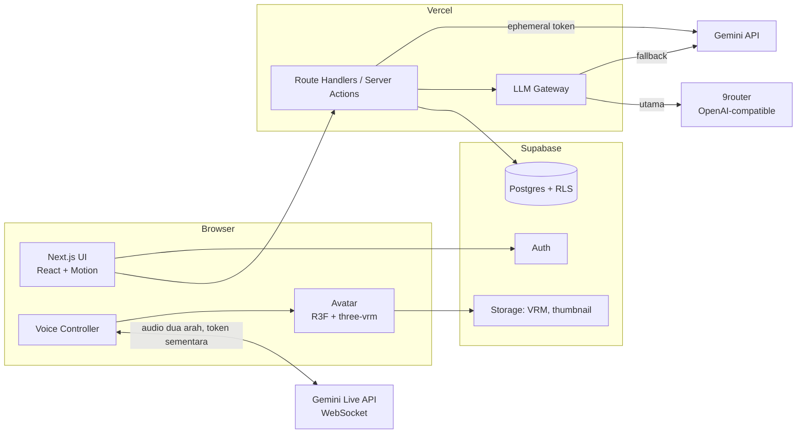
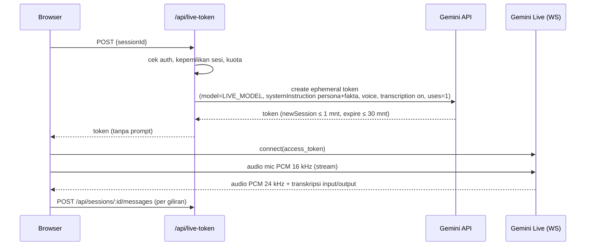
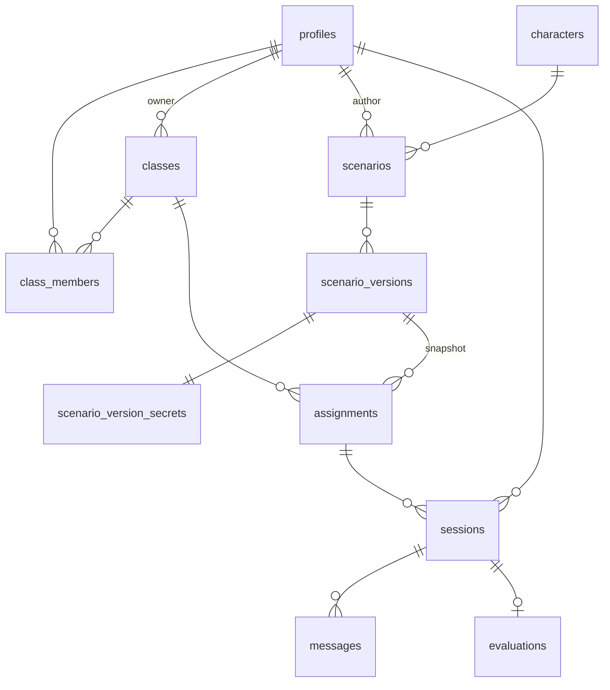

# Architecture

## 1. Gambaran sistem



Prinsip:

- **Monolit Next.js.** Tidak ada backend terpisah. Semua logika server ada di Route Handlers dan Server Actions.
- **Secret hanya di server.** Browser tidak pernah memegang `GEMINI_API_KEY` atau `NINEROUTER_API_KEY`. Untuk Live, browser hanya menerima **ephemeral token** yang berumur pendek.
- **Data rahasia skenario hanya di server.** Fakta tersembunyi dan rubrik tidak pernah dikirim ke browser pelajar.

## 2. Struktur modul (rencana)

```
src/
  app/
    (marketing)/            landing
    (auth)/                 login, daftar, ganti password
    (app)/
      dashboard/
      kelas/[id]/
      tugas/[id]/
      pustaka/
      skenario/             editor (Pengajar)
      admin/
    sesi/[id]/              ruang wawancara (layout "panggung")
    api/
      live-token/           POST: ephemeral token Gemini Live
      sessions/             start, messages, end
      chat/                 fallback: stream jawaban persona
      scenarios/generate/   generator skenario
      grade/                (internal) penilaian
  features/
    interview/              voice controller, state machine, transcript
    avatar/                 VRM loader, lip-sync, idle/blink/gesture
    scenario/               editor, skema Zod
    grading/                grader, skema output
    classroom/              kelas, tugas, anggota
  lib/
    llm/                    gateway (9router → Gemini), prompts/
    supabase/               client server/browser, types (generated)
    validation/             skema Zod bersama
  components/ui/            shadcn (dikustom)
```

Struktur dipecah **per fitur**. Abstraksi baru dibuat hanya ketika pola yang sama muncul untuk ketiga kalinya.

## 3. Voice pipeline

### 3.1 Mode Live (utama)



- **Prompt dikunci di dalam token (terverifikasi spike 2026-10-14).** Server membuat token lewat `POST v1beta/auth_tokens` dengan `bidiGenerateContentSetup` lengkap (model, `systemInstruction`, voice, `responseModalities`, transkripsi) dan **tanpa `fieldMask`**. Menurut referensi API, setup efektif lalu "taken entirely from `bidiGenerateContentSetup`… the setup message from the Live API connection is ignored".
  - Hasil uji: client yang mengirim instruksi berbeda tetap mendapat jawaban dari instruksi server. Ini berlaku di `gemini-3.8-live` maupun `gemini-2.5-flash-native-audio-latest`.
  - `fieldMask` parsial ditolak API (400) kalau setup berisi field di luar mask, jadi jangan dipakai.
  - Token (`auth_tokens/<id>`) tidak mengandung isi prompt, dan `uses: 1` benar ditegakkan (pemakaian kedua → `1011 Token has been used too many times`).
- **Endpoint.** `wss://generativelanguage.googleapis.com/ws/google.ai.generativelanguage.v1beta.GenerativeService.BidiGenerateContentConstrained?access_token=<token>` (**v1beta**, terverifikasi).
- **Model.** Diambil dari env `LIVE_MODEL`, tidak di-hardcode. Rekomendasi saat spike: `gemini-3.8-live` (setup + jawaban pendek ±3 dtk). Model Live lain di akun: `gemini-2.5-flash-native-audio-latest`, `gemini-3.1-flash-live-preview`.
- **Jangan pakai teks `modelTurn` untuk transkrip.** Model native-audio mengirim teks penalaran ("thinking") sebagai part teks, dan penalaran itu bisa menyebut fakta tersembunyi. Transkrip karakter **hanya** diambil dari `outputTranscription`, dan ucapan pelajar dari `inputTranscription`.
- **Kuota free tier (spike):** sekitar **6 sesi Live bersamaan** per project (8 koneksi serentak → 6 berhasil, 2 ditolak `1011 exceeded your current quota`). `LIVE_MAX_CONCURRENT` default **5**; sesi berikutnya langsung masuk Fallback. Kuota per menit/hari belum diukur.
- **Durasi.** Durasi sesi maksimal mengikuti `expireTime` token, yang diset ≥ durasi tugas + 2 menit.
- **Barge-in.** Ditangani oleh VAD bawaan Live API. Saat event interrupt datang, client menghentikan antrean audio yang sedang diputar.

### 3.2 Mode Fallback (pipeline gratis)

1. **Masuk mode fallback** saat: koneksi Live gagal dalam 5 detik, menerima error 429 atau error kuota, atau koneksi putus di tengah sesi.
2. **STT.** Memakai `SpeechRecognition` (Web Speech API) dengan `lang` sesuai bahasa skenario. Kalau browser tidak mendukung, input teks menjadi input utama.
3. **LLM.** `POST /api/chat`: server menyusun prompt persona + riwayat transkrip, lalu memanggil LLM Gateway (`CHAT_MODEL`). Jawaban di-stream.
4. **TTS.** Memakai `speechSynthesis` dengan voice yang paling cocok untuk bahasa dan gender karakter.

### 3.3 Kepercayaan transkrip

Transkrip mode Live dikirim **dari browser**, jadi secara teori bisa dipalsukan oleh pelajar yang paham teknis. Mitigasi di MVP:

- **Validasi giliran di server.** Server memvalidasi urutan giliran, panjang pesan, dan rate pesan.
- **Grader mewaspadai anomali.** Grader diinstruksikan untuk menandai pola tidak wajar, mis. karakter menyebut fakta tanpa ada pertanyaan pemicunya.
- **Review Pengajar** tetap menjadi kontrol akhir.

Kalau nanti dipakai untuk ujian bernilai tinggi, upgrade ke relay WebSocket di VPS AWS, sehingga server sendiri yang mencatat transkrip (ADR-002).

## 4. LLM Gateway

Satu modul `lib/llm/gateway.ts` memakai SDK `openai` dengan `baseURL` yang bisa dikonfigurasi. Endpoint OpenAI-compatible milik Gemini dipakai sebagai fallback.

| Tugas | Utama | Fallback | Model env |
|---|---|---|---|
| Suara Live | Gemini Live (key langsung) | Pipeline gratis (§3.2) | `LIVE_MODEL` |
| Chat persona (fallback mode) | 9router | Gemini | `CHAT_MODEL` / `GEMINI_FALLBACK_MODEL` |
| Penilaian rubrik | 9router | Gemini | `GRADER_MODEL` / `GEMINI_FALLBACK_MODEL` |
| Generator skenario | 9router | Gemini | `GRADER_MODEL` |

Aturan:

- **Kapan fallback.** Fallback dipicu oleh error 5xx, 429, timeout (chat 15 dtk, grader 60 dtk), atau output yang gagal divalidasi Zod setelah 1 kali retry.
- **Output terstruktur.** Output terstruktur (grader, generator) memakai JSON mode / `response_format`, lalu **selalu** divalidasi ulang dengan Zod di server.
- **Temuan 9router (2026-10-13):**
  - Tanpa `stream: false` eksplisit, 9router membalas dalam format SSE. Gateway selalu mengirim `stream: false`.
  - `response_format: json_object` diabaikan; jawaban bisa dibungkus ```` ```json ```` + teks tambahan. Parser M4 harus mengambil blok JSON pertama sebelum validasi Zod.
  - Latensi `ag/gemini-3.8-flash` lewat 9router sekitar 5,5–6,5 dtk per jawaban pendek. Ini melebihi target mode fallback (< 3 dtk); ukur ulang di M3 dan pertimbangkan Gemini langsung untuk chat persona.
- **Pencatatan.** Setiap panggilan mencatat provider, model, latensi, status, dan jumlah token ke tabel `llm_calls` untuk dipantau Admin. Isi prompt tidak ikut dicatat.

## 5. Avatar & lip-sync

- **Loader.** `GLTFLoader` + `VRMLoaderPlugin` (`@pixiv/three-vrm` 3.x) di dalam React Three Fiber. VRM dimuat dari Supabase Storage dan di-preload saat lobby.
- **Lip-sync mode Live.** Audio PCM diputar lewat `AudioContext` dan disambungkan ke `AnalyserNode`.
  - **Amplitudo** (RMS) menggerakkan `aa`.
  - **Energi pita frekuensi** dipakai untuk memperkirakan vokal dan menggerakkan ekspresi VRM `aa/ih/ou/ee/oh`, dengan smoothing 60–80 ms.
- **Lip-sync mode Fallback.** `speechSynthesis` tidak menyediakan stream audio. Karena itu dipakai event `onboundary` (batas kata) ditambah pemetaan huruf → vokal → viseme, dengan durasi yang diperkirakan dari rate bicara. Hasilnya cukup meyakinkan untuk karakter stylized.
- **Hidup.**
  - Kedip acak setiap 2–6 detik.
  - Idle breathing dan look-at ke kamera (atau ke kursor di desktop).
  - Gesture ringan per state, mis. mengangguk saat mendengarkan.
  - Bertopang dagu saat "berpikir".
- **Performa.**
  - Pixel ratio dibatasi `min(devicePixelRatio, 1.5)` di mobile.
  - Render on-demand saat tab tidak aktif.
  - Ukuran VRM ≤ 8 MB.

## 6. Data model



| Tabel | Kolom penting |
|---|---|
| `profiles` | `id` (= auth.users.id), `role` (`admin`/`pengajar`/`pelajar`), `status` (`active`/`pending`/`disabled`), `display_name`, `username`, `must_change_password`, `mic_consent_at` |
| `classes` | `id`, `owner_id`, `name`, `join_code` (unique), `archived_at` |
| `class_members` | `class_id`, `user_id`, `joined_at`. PK gabungan |
| `characters` | `id` (slug), `name`, `occupation`, `age_range`, `gender`, `live_voice` (suara melekat di karakter), `portrait_hue`, `vrm_path` (M3), `active`, `sort`. Seed 6 karakter |
| `scenarios` | `id`, `author_id`, `title`, `draft` (jsonb, autosave editor, hanya penulis), `is_public` (hanya bila sudah terbit), `current_version_id` |
| `scenario_versions` | **Brief** yang boleh dilihat pelajar: `id`, `scenario_id`, `version`, `title`, `language`, `level`, `learner_role`, `objective`, `client_name`, `client_occupation`, `character_id`, `published_at`. Immutable; dibuat hanya lewat RPC `publish_scenario()` |
| `scenario_version_secrets` | **Rahasia**: `version_id`, `persona`, `facts` (F1..Fn), `rubric` (jsonb, divalidasi Zod `contentSchema`). Hanya penulis & admin; server membacanya untuk prompt/grader |
| `library_versions` (view) | Versi terkini dari skenario publik (`security_invoker`, RLS tetap berlaku) |
| `assignments` | `id`, `class_id`, `scenario_version_id`, `due_at`, `duration_min` (15), `max_attempts` (3) |
| `sessions` | `id`, `user_id`, `kind` (`assignment`/`library`/`preview`), `assignment_id` (null bila pustaka/preview atau tugas dihapus), `scenario_version_id`, `mode` (`live`/`fallback`), `status` (`active`/`ended`/`grading`/`graded`/`grading_failed`), `prompt_version`, `started_at`, `ends_at` (otoritatif server), `ended_at`. Ditulis hanya lewat RPC |
| `messages` | PK `(session_id, seq)`, `speaker` (`learner`/`character`), `text` (≤ 2000), `created_at`. Ditulis hanya lewat `append_message()` |
| `evaluations` | `session_id`, `ai_result` (jsonb), `ai_score`, `final_score`, `override` (jsonb), `reviewer_id`, `comment`, `grader_model`, `prompt_version` |
| `llm_calls` | `id`, `task`, `provider`, `model`, `latency_ms`, `status`, `tokens_in/out`, `session_id?` |
| `audit_log` | `actor_id`, `action`, `target`, `created_at` |

Nilai terbaik per tugas tidak disimpan sebagai kolom. Nilai ini dihitung lewat view `assignment_best_scores` (MAX dari `coalesce(final_score, ai_score)`).

## 6a. Auth & sesi (M1)

- **Sesi:** `@supabase/ssr` dengan cookie. `src/proxy.ts` (pengganti `middleware` di Next.js 16) memanggil `getClaims()` sekali per navigasi untuk me-refresh token, lalu melakukan gating kasar:
  - Rute yang dilindungi → redirect ke `/masuk?next=…`.
  - User yang sudah login dan membuka `/masuk` atau `/daftar` → redirect ke `/dashboard`.
- **DAL:** `src/features/auth/dal.ts`.
  - `getCurrentUser()`: identitas dari `getClaims()` (JWT terverifikasi) + baris `profiles` milik sendiri, di-dedupe per request.
  - `requireUser({ roles, allowPending, allowPasswordChange })` dipanggil ulang di setiap halaman dan server action. Proxy bukan satu-satunya pengaman.
- **Cache Components:** `cacheComponents: true` membuat pembacaan cookie di luar `<Suspense>` gagal saat build. Karena itu setiap bagian yang membaca sesi dibungkus `<Suspense>`, dan halaman dirender sebagai Partial Prerender.
- **`connection()` di `createClient()`:** supabase-js memanggil `Date.now()` (cek kedaluwarsa token), sementara Cache Components melarang pemanggilan itu saat runtime prerender. `connection()` menunda semua render berbasis sesi ke waktu request.
- **Jebakan `cache()`:** cache React berlaku untuk seluruh request action, **termasuk** render hasil `redirect()`. Action yang mengubah profil pemanggil (mis. menghapus `must_change_password`) memakai `loadCurrentUser()` yang tidak di-cache.
- **Action yang menulis cookie sesi** (mis. `updateUser` merotasi token) memicu refresh halaman aktif, yang berebut dengan `redirect()`. Ganti password karena itu diakhiri dengan navigasi penuh dari client.
- **Form & React 19:** form otomatis di-reset setelah action selesai. Action mengembalikan `values` (field non-rahasia), dan input memakainya sebagai `defaultValue` supaya isian tidak hilang saat terjadi error.
- **Akun tanpa email (US-P-02):** username dipetakan ke email sintetis `username@pelajar.interview-ai.invalid` (TLD `.invalid`, RFC 2606, tidak pernah bisa menerima email). Field login menerima "email atau username".
- **Status akun:**
  - `pending` (pengajar baru) hanya bisa melihat dashboard menunggu.
  - `disabled` diblokir dua lapis: `profiles.status` + `ban_duration` di Supabase Auth. Sesi lama dibersihkan lewat `/keluar`.
  - `must_change_password` memaksa ke `/ganti-password`.
- **Kode kelas:** 6 karakter dari 31 huruf/angka tanpa `I O 0 1`. Gabung lewat RPC `join_class()`, yang mengembalikan `null` sama persis untuk kode salah maupun kelas yang diarsipkan.

## 7. RLS (ringkas)

| Tabel | Pelajar | Pengajar | Admin |
|---|---|---|---|
| `sessions`, `messages` | baris miliknya | sesi pada kelas miliknya + preview miliknya | semua |
| `evaluations` | baca miliknya, tanpa kolom fakta mentah | baca + update override di kelasnya | semua |
| `scenarios` (draf) | **tidak ada akses** | skenario buatannya | semua |
| `scenario_version_secrets` | **tidak ada akses** | skenario buatannya | semua |
| `scenario_versions` (brief) | versi yang ditugaskan ke kelasnya + versi publik terkini | buatannya + yang ditugaskan + publik terkini | semua |
| `assignments` | kelas yang diikuti | kelas miliknya (buat/ubah/hapus) | semua |
| `classes` | kelas yang diikuti | kelas miliknya | semua |

Data yang perlu fakta (persona prompt, grader) dibaca oleh server dengan service role, setelah otorisasi dicek di kode. Detail lengkap: [security-privacy.md](security-privacy.md).

## 8. API (Route Handlers)

| Method & path | Fungsi | Auth |
|---|---|---|
| `POST /api/sessions` | Mulai sesi (cek tenggat, percobaan, kuota; attempt −1) | pelajar/pengajar |
| `POST /api/live-token` | Ephemeral token Live untuk sesi aktif | pemilik sesi |
| `POST /api/sessions/:id/messages` | Simpan giliran (validasi seq, panjang ≤ 2000) | pemilik sesi |
| `POST /api/chat` | Stream jawaban persona (mode fallback) | pemilik sesi |
| `POST /api/sessions/:id/end` | Akhiri + penilaian | pemilik sesi / sistem |
| `POST /api/scenarios/generate` | Draf skenario dari ringkasan | pengajar |
| `POST /api/evaluations/:id/override` | Override nilai | pengajar kelas |
| `POST /api/classes/:id/bulk-students` | Buat akun massal dari CSV | pengajar kelas |

Mutasi CRUD sederhana (kelas, tugas, edit skenario) memakai Server Actions. Semua input divalidasi dengan Zod.

### 8a. RPC sesi (M3)

| RPC | Aturan |
|---|---|
| `start_session(kind, assignment_id, version_id, prompt_version)` | Satu sesi aktif per pengguna; tugas: anggota kelas + pelajar aktif, sebelum tenggat, percobaan tersisa (dihitung saat mulai); pustaka: versi publik terkini, 3/hari; preview: penulis aktif. Durasi = tugas / 15 / 10 menit |
| `append_message(session_id, speaker, text)` | Pemilik; status aktif sampai `ends_at` + 1 mnt; `seq` berurutan (row lock); 30 giliran/menit |
| `end_session(session_id)` | Pemilik |
| `claim_live_slot(session_id, max)` / `release_live_slot` | Advisory lock; hitung sesi `live` aktif proyek. Server memanggilnya sebelum membuat token |

Server action di `src/features/interview/actions.ts`: `startSession`, `requestLiveToken`, `releaseLive`, `logTurn` (Live), `chatTurn` (mode hemat), `endSession`, `giveMicConsent`.

**Catatan implementasi Live (M3):** browser mengirim `setup: { model }` saja (setup sebenarnya terkunci di token); audio mikrofon PCM16 16 kHz lewat AudioWorklet (`public/pcm-recorder-worklet.js`); audio balasan PCM 24 kHz diantrekan tanpa jeda; `interrupted` menghentikan antrean (barge-in). Pembuka Live dipicu isyarat teks yang tidak dicatat; pembuka mode hemat memakai `openingLine` tanpa LLM.

## 9. Kuota & rate limit

- **Per pelajar:**
  - Sesi pustaka: maksimal 3 per hari.
  - Hanya 1 sesi aktif dalam satu waktu.
  - `messages`: maksimal 30 per menit.
- **Per institusi:** batas sesi Live bersamaan diatur di env (`LIVE_MAX_CONCURRENT`, default 10). Kalau terlewati, sesi baru langsung masuk Fallback.
- **Implementasi:** hitungan diambil dari tabel di Postgres. Belum perlu Redis.

## 10. Observability

- **Tabel `llm_calls`** menjadi sumber halaman pemantauan Admin (sesi per hari, % fallback, error provider).
- **Vercel logs** untuk error server. Error client dikirim ke route `/api/client-errors` (mudah diganti Sentry nanti).
