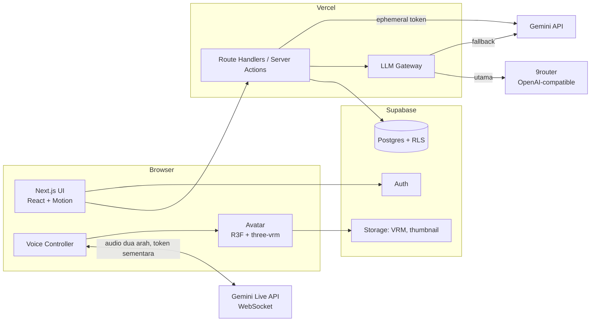
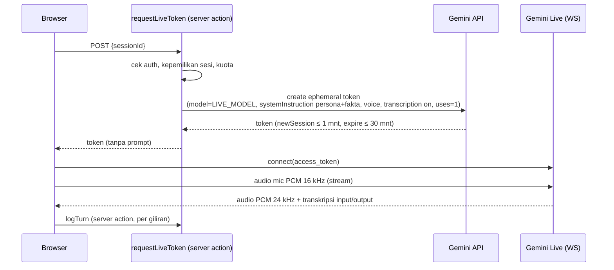
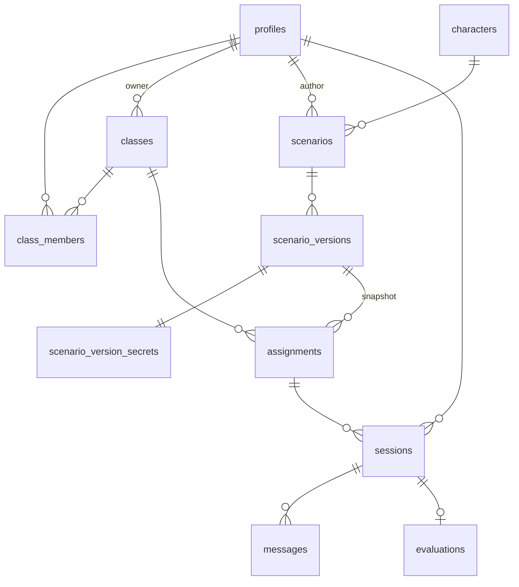

# Architecture

## 1. Gambaran sistem



Prinsip:

- **Monolit Next.js.** Tidak ada backend terpisah. Semua logika server ada di Route Handlers dan Server Actions.
- **Secret hanya di server.** Browser tidak pernah memegang `GEMINI_API_KEY` atau `NINEROUTER_API_KEY`. Untuk Live, browser hanya menerima **ephemeral token** yang berumur pendek.
- **Data rahasia skenario hanya di server.** Fakta tersembunyi dan rubrik tidak pernah dikirim ke browser pelajar.

## 2. Struktur modul (rencana)

```
src/
  app/
    (marketing)/            landing
    (auth)/                 login, daftar, ganti password
    (app)/
      dashboard/
      kelas/[id]/
      tugas/[id]/
      pustaka/
      skenario/             editor (Pengajar)
      admin/
    sesi/[id]/              ruang wawancara (layout "panggung")
    auth/callback/          OAuth callback (Route Handler)
    keluar/                 sign-out (Route Handler)
  features/
    interview/              server actions sesi (actions.ts, voice.ts), voice controller, transcript
    avatar/                 VRM loader, lip-sync, idle/blink/gesture
    scenario/               editor, skema Zod
    grading/                grader, skema output
    classroom/              kelas, tugas, anggota
  lib/
    llm/                    gateway (9router → Gemini), prompts/
    supabase/               client server/browser, types (generated)
    validation/             skema Zod bersama
  components/ui/            shadcn (dikustom)
```

Struktur dipecah **per fitur**. Abstraksi baru dibuat hanya ketika pola yang sama muncul untuk ketiga kalinya.

## 3. Voice pipeline

### 3.1 Mode Live (utama)



- **Prompt dikunci di dalam token (terverifikasi spike 2026-10-14).** Server membuat token lewat `POST v1beta/auth_tokens` dengan `bidiGenerateContentSetup` lengkap (model, `systemInstruction`, voice, `responseModalities`, transkripsi) dan **tanpa `fieldMask`**. Menurut referensi API, setup efektif lalu "taken entirely from `bidiGenerateContentSetup`… the setup message from the Live API connection is ignored".
  - Hasil uji: client yang mengirim instruksi berbeda tetap mendapat jawaban dari instruksi server. Ini berlaku di `gemini-3.8-live` maupun `gemini-2.5-flash-native-audio-latest`.
  - `fieldMask` parsial ditolak API (400) kalau setup berisi field di luar mask, jadi jangan dipakai.
  - Token (`auth_tokens/<id>`) tidak mengandung isi prompt, dan `uses: 1` benar ditegakkan (pemakaian kedua → `1011 Token has been used too many times`).
- **Endpoint.** `wss://generativelanguage.googleapis.com/ws/google.ai.generativelanguage.v1beta.GenerativeService.BidiGenerateContentConstrained?access_token=<token>` (**v1beta**, terverifikasi).
- **Model.** Diambil dari env `LIVE_MODEL`, tidak di-hardcode. Rekomendasi saat spike: `gemini-3.8-live` (setup + jawaban pendek ±3 dtk). Model Live lain di akun: `gemini-2.5-flash-native-audio-latest`, `gemini-3.1-flash-live-preview`.
- **Jangan pakai teks `modelTurn` untuk transkrip.** Model native-audio mengirim teks penalaran ("thinking") sebagai part teks, dan penalaran itu bisa menyebut fakta tersembunyi. Transkrip karakter **hanya** diambil dari `outputTranscription`, dan ucapan pelajar dari `inputTranscription`.
- **Kuota free tier (spike):** sekitar **6 sesi Live bersamaan** per project (8 koneksi serentak → 6 berhasil, 2 ditolak `1011 exceeded your current quota`). `LIVE_MAX_CONCURRENT` default **5**; sesi berikutnya langsung masuk Fallback. Kuota per menit/hari belum diukur.
- **Durasi.** Durasi sesi maksimal mengikuti `expireTime` token, yang diset ≥ durasi tugas + 2 menit.
- **Barge-in.** Ditangani oleh VAD bawaan Live API. Saat event interrupt datang, client menghentikan antrean audio yang sedang diputar.

### 3.2 Mode Fallback (mode hemat)

1. **Masuk mode fallback** saat: koneksi Live gagal dalam 5 detik, menerima error 429 atau error kuota, atau koneksi putus di tengah sesi.
2. **STT.** Memakai `SpeechRecognition` (Web Speech API) dengan `lang` sesuai bahasa skenario. Kalau browser tidak mendukung, input teks menjadi input utama.
3. **LLM.** Server action `chatTurn`: server menyimpan giliran pelajar, menyusun prompt persona + riwayat transkrip, memanggil LLM Gateway (`CHAT_MODEL`), lalu menyimpan dan mengembalikan jawaban utuh (tidak di-stream).
4. **TTS.** Server action `speakLastReply` (`src/features/interview/voice.ts`) membacakan jawaban karakter terakhir yang **sudah tersimpan** di sesi milik pelajar, **sekali per jawaban** lewat RPC `claim_tts` (browser tidak mengirim teks) lewat Gemini TTS (`TTS_MODEL`), dengan `live_voice` karakter yang sama dengan Live. Teks jawaban tampil dulu; audio (PCM 24 kHz) menyusul ±5–6 detik dan diputar oleh `PcmPlayer` yang sama dengan Live, sehingga lip-sync memakai level audio sungguhan. Bila TTS gagal/kuota habis: teks saja. `speechSynthesis` tidak dipakai: uji 2026-10-14 menunjukkan suara perangkat tanpa id-ID membaca bahasa Indonesia dengan pelafalan Inggris (ADR-002, amandemen).
   - **Temuan uji Live 2026-10-14:** `gemini-3.8-live` dan `gemini-2.5-flash-native-audio-latest` melafalkan bahasa Indonesia dengan baik tanpa `languageCode`; mengirim `speechConfig.languageCode: "id-ID"` membuat keduanya tidak menjawab. Jadi `languageCode` tidak dikirim.

### 3.3 Kepercayaan transkrip

Transkrip mode Live dikirim **dari browser**, jadi secara teori bisa dipalsukan oleh pelajar yang paham teknis. Mitigasi di MVP:

- **Validasi giliran di server.** Server memvalidasi urutan giliran, panjang pesan, dan rate pesan.
- **Grader mewaspadai anomali.** Grader diinstruksikan untuk menandai pola tidak wajar, mis. karakter menyebut fakta tanpa ada pertanyaan pemicunya.
- **Review Pengajar** tetap menjadi kontrol akhir.

Kalau nanti dipakai untuk ujian bernilai tinggi, upgrade ke relay WebSocket di VPS AWS, sehingga server sendiri yang mencatat transkrip (ADR-002).

## 4. LLM Gateway

Satu modul `lib/llm/gateway.ts` memakai SDK `openai` dengan `baseURL` yang bisa dikonfigurasi. Endpoint OpenAI-compatible milik Gemini dipakai sebagai fallback.

| Tugas | Utama | Fallback | Model env |
|---|---|---|---|
| Suara Live | Gemini Live (key langsung) | Mode hemat (§3.2) | `LIVE_MODEL` |
| Suara karakter mode hemat | Gemini TTS (key langsung) | Teks saja | `TTS_MODEL` |
| Chat persona (fallback mode) | 9router | Gemini | `CHAT_MODEL` / `GEMINI_FALLBACK_MODEL` |
| Penilaian rubrik | 9router | Gemini | `GRADER_MODEL` / `GEMINI_FALLBACK_MODEL` |
| Generator skenario | 9router | Gemini | `GRADER_MODEL` |

Aturan:

- **Kapan fallback.** Fallback dipicu oleh error 5xx, 429, timeout (chat 15 dtk, grader 60 dtk), atau output yang gagal divalidasi Zod setelah 1 kali retry.
- **Output terstruktur.** Output terstruktur (grader, generator) memakai JSON mode / `response_format`, lalu **selalu** divalidasi ulang dengan Zod di server.
- **Temuan 9router (2026-10-13):**
  - Tanpa `stream: false` eksplisit, 9router membalas dalam format SSE. Gateway selalu mengirim `stream: false`.
  - `response_format: json_object` diabaikan; jawaban bisa dibungkus ```` ```json ```` + teks tambahan. Parser M4 harus mengambil blok JSON pertama sebelum validasi Zod.
  - Latensi `ag/gemini-3.8-flash` lewat 9router sekitar 5,5–6,5 dtk per jawaban pendek. Ini melebihi target mode fallback (< 3 dtk); ukur ulang di M3 dan pertimbangkan Gemini langsung untuk chat persona.
- **Pencatatan.** Setiap panggilan mencatat provider, model, latensi, status, dan jumlah token ke tabel `llm_calls` untuk dipantau Admin. Isi prompt tidak ikut dicatat.

## 5. Avatar & lip-sync

- **Loader.** `GLTFLoader` + `VRMLoaderPlugin` (`@pixiv/three-vrm` 3.x) di dalam React Three Fiber. VRM dimuat dari Supabase Storage dan di-preload saat lobby.
- **Lip-sync mode Live.** Audio PCM diputar lewat `AudioContext` dan disambungkan ke `AnalyserNode`.
  - **Amplitudo** (RMS) menggerakkan `aa`.
  - **Energi pita frekuensi** dipakai untuk memperkirakan vokal dan menggerakkan ekspresi VRM `aa/ih/ou/ee/oh`, dengan smoothing 60–80 ms.
- **Lip-sync mode Fallback.** Audio Gemini TTS diputar lewat `PcmPlayer` yang sama dengan Live, jadi lip-sync memakai level audio sungguhan (bukan perkiraan dari teks).
- **Hidup.**
  - Kedip acak setiap 2–6 detik.
  - Idle breathing dan look-at ke kamera (atau ke kursor di desktop).
  - Gesture ringan per state, mis. mengangguk saat mendengarkan.
  - Bertopang dagu saat "berpikir".
- **Performa.**
  - Pixel ratio dibatasi `min(devicePixelRatio, 1.5)` di mobile.
  - Render on-demand saat tab tidak aktif.
  - Ukuran VRM ≤ 8 MB.

## 6. Data model



| Tabel | Kolom penting |
|---|---|
| `profiles` | `id` (= auth.users.id), `role` (`admin`/`pengajar`/`pelajar`), `status` (`active`/`pending`/`disabled`), `display_name`, `username`, `must_change_password`, `mic_consent_at` |
| `classes` | `id`, `owner_id`, `name`, `join_code` (unique), `archived_at` |
| `class_members` | `class_id`, `user_id`, `joined_at`. PK gabungan |
| `characters` | `id` (slug), `name`, `occupation`, `age_range`, `gender`, `live_voice` (suara melekat di karakter), `portrait_hue`, `vrm_path` (M3), `active`, `sort`. Seed 6 karakter |
| `scenarios` | `id`, `author_id`, `title`, `draft` (jsonb, autosave editor, hanya penulis), `is_public` (hanya bila sudah terbit), `current_version_id` |
| `scenario_versions` | **Brief** yang boleh dilihat pelajar: `id`, `scenario_id`, `version`, `title`, `language`, `level`, `learner_role`, `objective`, `client_name`, `client_occupation`, `character_id`, `published_at`. Immutable; dibuat hanya lewat RPC `publish_scenario()` |
| `scenario_version_secrets` | **Rahasia**: `version_id`, `persona`, `facts` (F1..Fn), `rubric` (jsonb, divalidasi Zod `contentSchema`). Hanya penulis & admin; server membacanya untuk prompt/grader |
| `library_versions` (view) | Versi terkini dari skenario publik (`security_invoker`, RLS tetap berlaku) |
| `assignments` | `id`, `class_id`, `scenario_version_id`, `due_at`, `duration_min` (15), `max_attempts` (3) |
| `sessions` | `id`, `user_id`, `kind` (`assignment`/`library`/`preview`), `assignment_id` (null bila pustaka/preview atau tugas dihapus), `scenario_version_id`, `mode` (`live`/`fallback`), `status` (`active`/`ended`/`grading`/`graded`/`grading_failed`), `prompt_version`, `started_at`, `ends_at` (otoritatif server), `ended_at`. Ditulis hanya lewat RPC |
| `messages` | PK `(session_id, seq)`, `speaker` (`learner`/`character`), `text` (≤ 2000), `created_at`, `spoken_at` (jawaban karakter sudah dibacakan TTS mode hemat). Ditulis hanya lewat `append_message()` / `claim_tts()` |
| `evaluations` | `session_id`, `ai_result` (jsonb), `ai_score`, `final_score`, `override` (jsonb), `reviewer_id`, `comment`, `reviewed_at`, `review_seen_at`, `grader_model`, `prompt_version` |
| `llm_calls` | `id`, `task`, `provider`, `model`, `latency_ms`, `status`, `tokens_in/out`, `session_id?` |
| `audit_log` | `actor_id`, `action`, `target`, `created_at` |

Nilai terbaik per tugas tidak disimpan sebagai kolom. Nilai ini dihitung lewat view `assignment_scores` (MAX dari `final_score`, yang diisi `finish_grading` saat dinilai dan sama dengan `ai_score` sampai pengajar meninjau). Lihat §8b.

## 6a. Auth & sesi (M1)

- **Sesi:** `@supabase/ssr` dengan cookie. `src/proxy.ts` (pengganti `middleware` di Next.js 16) memanggil `getClaims()` sekali per navigasi untuk me-refresh token, lalu melakukan gating kasar:
  - Rute yang dilindungi → redirect ke `/masuk?next=…`.
  - User yang sudah login dan membuka `/masuk` atau `/daftar` → redirect ke `/dashboard`.
- **DAL:** `src/features/auth/dal.ts`.
  - `getCurrentUser()`: identitas dari `getClaims()` (JWT terverifikasi) + baris `profiles` milik sendiri, di-dedupe per request.
  - `requireUser({ roles, allowPending, allowPasswordChange })` dipanggil ulang di setiap halaman dan server action. Proxy bukan satu-satunya pengaman.
- **Cache Components:** `cacheComponents: true` membuat pembacaan cookie di luar `<Suspense>` gagal saat build. Karena itu setiap bagian yang membaca sesi dibungkus `<Suspense>`, dan halaman dirender sebagai Partial Prerender.
- **`connection()` di `createClient()`:** supabase-js memanggil `Date.now()` (cek kedaluwarsa token), sementara Cache Components melarang pemanggilan itu saat runtime prerender. `connection()` menunda semua render berbasis sesi ke waktu request.
- **Jebakan `cache()`:** cache React berlaku untuk seluruh request action, **termasuk** render hasil `redirect()`. Action yang mengubah profil pemanggil (mis. menghapus `must_change_password`) memakai `loadCurrentUser()` yang tidak di-cache.
- **Action yang menulis cookie sesi** (mis. `updateUser` merotasi token) memicu refresh halaman aktif, yang berebut dengan `redirect()`. Ganti password karena itu diakhiri dengan navigasi penuh dari client.
- **Form & React 19:** form otomatis di-reset setelah action selesai. Action mengembalikan `values` (field non-rahasia), dan input memakainya sebagai `defaultValue` supaya isian tidak hilang saat terjadi error.
- **Akun tanpa email (US-P-02):** username dipetakan ke email sintetis `username@pelajar.interview-ai.invalid` (TLD `.invalid`, RFC 2606, tidak pernah bisa menerima email). Field login menerima "email atau username".
- **Status akun:**
  - `pending` (pengajar baru) hanya bisa melihat dashboard menunggu.
  - `disabled` diblokir dua lapis: `profiles.status` + `ban_duration` di Supabase Auth. Sesi lama dibersihkan lewat `/keluar`.
  - `must_change_password` memaksa ke `/ganti-password`.
- **Kode kelas:** 6 karakter dari 31 huruf/angka tanpa `I O 0 1`. Gabung lewat RPC `join_class()`, yang mengembalikan `null` sama persis untuk kode salah maupun kelas yang diarsipkan.

## 7. RLS (ringkas)

| Tabel | Pelajar | Pengajar | Admin |
|---|---|---|---|
| `sessions`, `messages` | baris miliknya | sesi pada kelas miliknya + preview miliknya | semua |
| `evaluations` | baca miliknya (`ai_result` hanya berisi id fakta, bukan isi fakta) | baca di kelasnya; override lewat `reviewEvaluation` → RPC `review_evaluation` | semua |
| `assignment_scores` (view, `security_invoker`) | baris miliknya | kelas miliknya | semua |
| `scenarios` (draf) | **tidak ada akses** | skenario buatannya | semua |
| `scenario_version_secrets` | **tidak ada akses** | skenario buatannya | semua |
| `scenario_versions` (brief) | versi yang ditugaskan ke kelasnya + versi publik terkini | buatannya + yang ditugaskan + publik terkini | semua |
| `assignments` | kelas yang diikuti | kelas miliknya (buat/ubah/hapus) | semua |
| `classes` | kelas yang diikuti | kelas miliknya | semua |

Data yang perlu fakta (persona prompt, grader) dibaca oleh server dengan service role, setelah otorisasi dicek di kode. Detail lengkap: [security-privacy.md](security-privacy.md).

## 8. Server Actions & Route Handlers

Mutasi memakai **Server Actions** (tidak ada folder `app/api`). Setiap action memanggil `requireUser` → cek kepemilikan → validasi Zod → aksi/RPC. Route Handler hanya untuk `auth/callback` (OAuth) dan `keluar` (sign-out).

| Action | File | Fungsi | Auth |
|---|---|---|---|
| `startSession` | `features/interview/actions.ts` | Mulai sesi lewat RPC `start_session` (tenggat, percobaan, kuota) | pelajar/pengajar |
| `requestLiveToken` / `releaseLive` | `features/interview/actions.ts` | Ephemeral token Live + slot Live | pemilik sesi |
| `logTurn` | `features/interview/actions.ts` | Simpan giliran mode Live (≤ 2000 karakter) | pemilik sesi |
| `chatTurn` | `features/interview/actions.ts` | Jawaban persona mode hemat | pemilik sesi |
| `speakLastReply` | `features/interview/voice.ts` | Suara karakter mode hemat (Gemini TTS, sekali per jawaban via `claim_tts`) | pemilik sesi |
| `endSession` | `features/interview/actions.ts` | Akhiri sesi, lalu jadwalkan `gradeSession` dengan `after()` (tidak menahan redirect; `maxDuration` 300 dtk di halaman) | pemilik sesi |
| `reviewEvaluation` | `features/grading/actions.ts` | Override level per kriteria + komentar; nilai final dihitung ulang di server (`applyOverride` + `computeScore`) | pengajar pemilik kelas / admin |
| `regradeSession` | `features/grading/actions.ts` | Nilai ulang sesi `grading_failed` (klaim dulu, LLM jalan lewat `after()`) | pengajar pemilik kelas / admin; pemilik sesi untuk Pustaka & preview |
| `generateDraft`, `saveDraft`, `publishScenario`, `setScenarioPublic` | `features/scenario/actions.ts` | Generator & editor skenario | pengajar (penulis) |
| `createClass`, `joinClass`, `bulkCreateStudents`, `createAssignment`, … | `features/classroom/actions.ts` | Kelas, anggota, tugas | sesuai peran |
| `resetPassword`, `updateUserAccess` | `features/auth`, `features/admin` | Reset password, akses pengguna | admin/pengajar kelas |

**Penilaian (M4, `features/grading/`).** `gradeSession` berjalan sebagai service role setelah kepemilikan dicek: `claim_grading` → baca transkrip + rahasia skenario → `runGrader` (prompt `grader@1`, gateway task `grader`, `extractJson`, validasi Zod + validator bukti, hingga 3 percobaan dengan backoff 0/2/6 dtk, umpan balik saat JSON tidak valid) → `finish_grading`. Nilai dihitung di kode (`computeScore`). Halaman `/sesi/[id]/selesai` juga memicu `gradeSession` (lewat `after()`) bila pemiliknya membuka sesi yang sudah berakhir tapi belum dinilai, mis. sesi yang ditutup timer, lalu memuat ulang sendiri tiap 5 dtk selama diproses. Pengajar meninjau dari tombol **Hasil** per tugas di halaman kelas → `/kelas/[id]/tugas/[tugasId]` (dashboard tugas, US-G-08) → halaman ringkasan sesi (bagian "Tinjau nilai"). Notifikasi ke pelajar (US-G-07) bersifat in-app: dashboard pelajar menampilkan "Nilai baru dari pengajar" untuk evaluasi dengan `reviewed_at` terisi dan `review_seen_at` kosong; membuka ringkasan sesi memanggil `mark_review_seen`.

**Dashboard tugas (US-G-08, `features/grading/class-dashboard.ts`).** Halaman `/kelas/[id]/tugas/[tugasId]` hanya untuk pengajar pemilik kelas dan admin. Isinya: tabel pelajar (status belum mulai / berjalan / selesai / dinilai, percobaan dan nilai terbaik dari `assignment_scores`, tautan ke percobaan dengan nilai terbaik), sebaran nilai terbaik per rentang 10, 5 fakta yang paling sering terlewat, dan semua percobaan. Agregasi dilakukan di Server Component: `ai_result` (hanya id fakta) dibaca lewat RLS, daftar fakta lewat `loadScenarioContent` setelah cek akses. Sebuah fakta dihitung terlewat oleh pelajar bila tidak ditemukan di percobaan bernilai mana pun miliknya. **Isi fakta hanya dirender untuk penulis skenario**; pengajar lain (skenario Pustaka) dan admin hanya melihat kategorinya.

**Ekspor nilai (US-G-09).** Route handler `GET /kelas/[id]/tugas/[tugasId]/nilai-csv` memakai loader yang sama dengan dashboard tugas (`features/grading/assignment-results.ts`, otorisasi pemilik kelas/admin, nilai dari `assignment_scores`). Isinya satu baris per pelajar kelas, termasuk yang belum mulai (nilai kosong): `nama, username, percobaan, nilai_final_terbaik, status`. Setiap sel lewat `csvCell` (cegah formula), UTF-8 dengan BOM, `Cache-Control: private, no-store`, nama file `nilai-<judul>-<YYYY-MM-DD>.csv`. Tugas yang tidak ada dan tugas milik orang lain sama-sama dijawab 404.

### 8b. RPC penilaian (M4)

Hanya `service_role` yang bisa memanggil; browser tidak pernah bisa menandai sesinya sendiri dinilai.

| RPC | Aturan |
|---|---|
| `claim_grading(session_id)` | Ubah status ke `grading` bila: `ended`, `grading_failed`, `active` yang lewat `ends_at` + 1 mnt, atau `grading` yang macet > 10 mnt setelah selesai. Syarat: ada minimal satu giliran pelajar (sesi tanpa pertanyaan tetap `ended`, tidak dinilai). `false` bila tidak ada yang perlu dinilai, sehingga pemanggilan ganda aman |
| `review_evaluation(session_id, reviewer, override, final_score, comment)` | Mengecek ulang `reviewer` = pengajar aktif pemilik kelas tugas itu atau admin aktif, sesi `graded` (gagal → `not_allowed`); memvalidasi sendiri `override` = tepat satu level bulat 1–4 untuk setiap kriteria rubrik versi skenario itu dan `final_score` 0–100 (gagal → `bad_override`); simpan `override` (`{ criteria: { [kriteria]: level } }`), `final_score`, `reviewer_id`, `comment` (kosong → null), `reviewed_at` = now, `review_seen_at` = null |
| `finish_grading(session_id, result, score, final_score, model, prompt_version)` | Hanya untuk sesi berstatus `grading`. `result` null → `grading_failed`; selain itu simpan `evaluations` dan status `graded`. `final_score` dihitung server: = `score` tanpa override, atau dihitung ulang dari hasil AI baru + override yang tersimpan |
| `mark_review_seen(session_id)` | Dipanggil pemilik sesi (authenticated) saat membuka ringkasan; set `review_seen_at` hanya bila `auth.uid()` = pemilik sesi dan sesi sudah ditinjau |

View `assignment_scores(assignment_id, user_id, attempts, best_score)`: jumlah percobaan dan **nilai final terbaik** per pelajar per tugas (PRD §5). Satu-satunya sumber nilai tugas untuk dashboard kelas (US-G-08) dan ekspor CSV (US-G-09).

### 8a. RPC sesi (M3)

| RPC | Aturan |
|---|---|
| `start_session(kind, assignment_id, version_id, prompt_version)` | Satu sesi aktif per pengguna; tugas: anggota kelas + pelajar aktif, sebelum tenggat, percobaan tersisa (dihitung saat mulai); pustaka: versi publik terkini, 3/hari; preview: penulis aktif. Durasi = tugas / 15 / 10 menit |
| `append_message(session_id, speaker, text)` | Pemilik; status aktif sampai `ends_at` + 1 mnt; `seq` berurutan (row lock); 30 giliran/menit |
| `end_session(session_id)` | Pemilik |
| `claim_live_slot(session_id, max)` / `release_live_slot` | Advisory lock; hitung sesi `live` aktif proyek. Server memanggilnya sebelum membuat token |
| `claim_tts(session_id)` | Pemilik, sesi aktif; mengembalikan teks giliran terakhir **hanya** bila itu jawaban karakter yang belum dibacakan, lalu menandai `spoken_at`. Mencegah kuota TTS dihabiskan dengan memutar ulang |

Server action di `src/features/interview/actions.ts`: `startSession`, `requestLiveToken`, `releaseLive`, `logTurn` (Live), `chatTurn` (mode hemat), `endSession`, `giveMicConsent`; dan `speakLastReply` di `voice.ts`.

**Catatan implementasi Live (M3):** browser mengirim `setup: { model }` saja (setup sebenarnya terkunci di token); audio mikrofon PCM16 16 kHz lewat AudioWorklet (`public/pcm-recorder-worklet.js`); audio balasan PCM 24 kHz diantrekan tanpa jeda; `interrupted` menghentikan antrean (barge-in). Pembuka Live dipicu isyarat teks yang tidak dicatat; pembuka mode hemat memakai `openingLine` tanpa LLM.

## 9. Kuota & rate limit

- **Per pelajar:**
  - Sesi pustaka: maksimal 3 per hari.
  - Hanya 1 sesi aktif dalam satu waktu.
  - `messages`: maksimal 30 per menit.
- **Per institusi:** batas sesi Live bersamaan diatur di env (`LIVE_MAX_CONCURRENT`, default 10). Kalau terlewati, sesi baru langsung masuk Fallback.
- **Implementasi:** hitungan diambil dari tabel di Postgres. Belum perlu Redis.

## 10. Observability

- **Tabel `llm_calls`** menjadi sumber halaman pemantauan Admin (sesi per hari, % fallback, error provider).
- **Vercel logs** untuk error server. Pelaporan error client (rencananya route `/api/client-errors`, mudah diganti Sentry) **belum diimplementasikan**.
