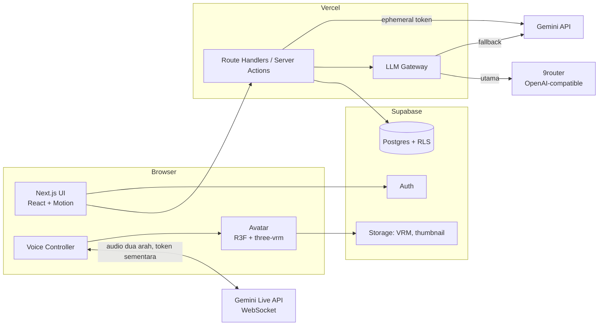
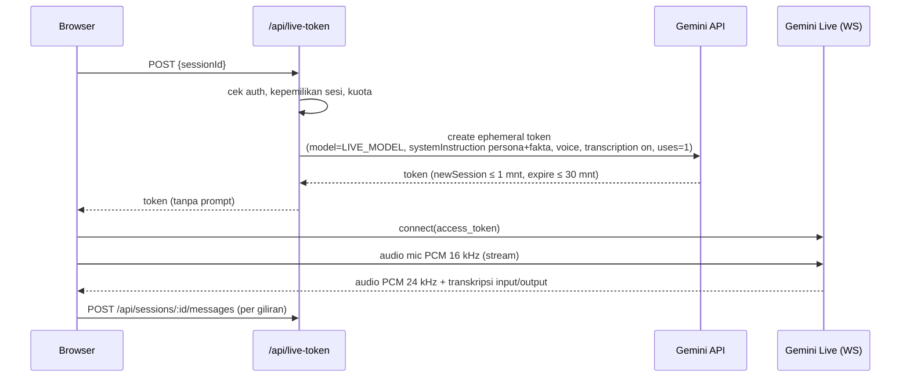
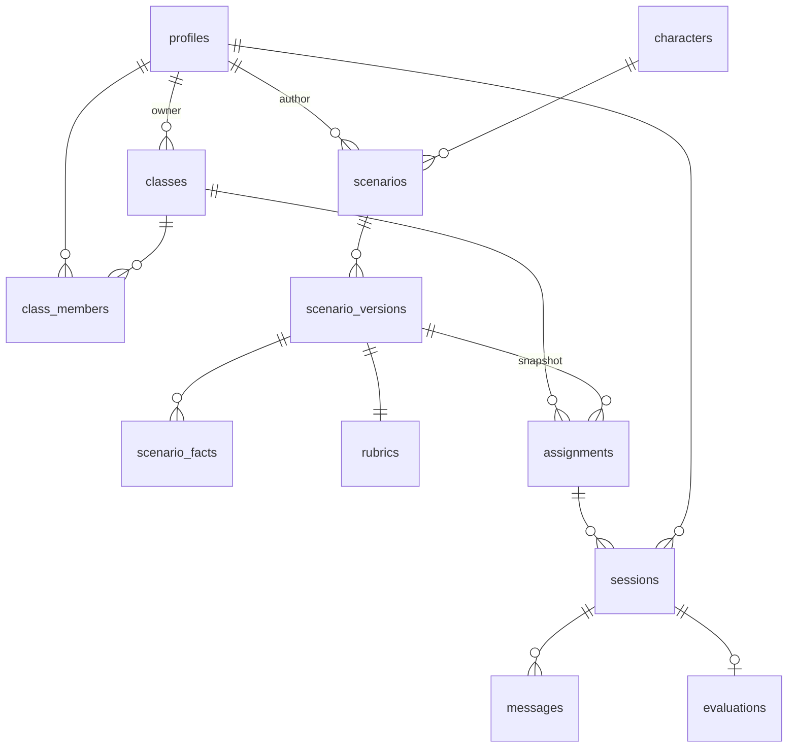

# Architecture

## 1. Gambaran sistem



Prinsip:

- **Monolit Next.js.** Tidak ada backend terpisah. Semua logika server ada di Route Handlers dan Server Actions.
- **Secret hanya di server.** Browser tidak pernah memegang `GEMINI_API_KEY` atau `NINEROUTER_API_KEY`. Untuk Live, browser hanya menerima **ephemeral token** yang berumur pendek.
- **Data rahasia skenario hanya di server.** Fakta tersembunyi dan rubrik tidak pernah dikirim ke browser pelajar.

## 2. Struktur modul (rencana)

```
src/
  app/
    (marketing)/            landing
    (auth)/                 login, daftar, ganti password
    (app)/
      dashboard/
      kelas/[id]/
      tugas/[id]/
      pustaka/
      skenario/             editor (Pengajar)
      admin/
    sesi/[id]/              ruang wawancara (layout "panggung")
    api/
      live-token/           POST: ephemeral token Gemini Live
      sessions/             start, messages, end
      chat/                 fallback: stream jawaban persona
      scenarios/generate/   generator skenario
      grade/                (internal) penilaian
  features/
    interview/              voice controller, state machine, transcript
    avatar/                 VRM loader, lip-sync, idle/blink/gesture
    scenario/               editor, skema Zod
    grading/                grader, skema output
    classroom/              kelas, tugas, anggota
  lib/
    llm/                    gateway (9router → Gemini), prompts/
    supabase/               client server/browser, types (generated)
    validation/             skema Zod bersama
  components/ui/            shadcn (dikustom)
```

Struktur dipecah **per fitur**. Abstraksi baru dibuat hanya ketika pola yang sama muncul untuk ketiga kalinya.

## 3. Voice pipeline

### 3.1 Mode Live (utama)



- **Prompt dikunci di dalam token.** Konfigurasi sesi (system instruction yang berisi persona dan fakta) dikunci lewat *constraints* token di server, jadi browser tidak pernah melihat prompt. ⚠️ **Perlu verifikasi** saat M3: pastikan constraints ephemeral token memang bisa mengunci `systemInstruction`. Kalau tidak bisa, pakai relay WebSocket di VPS AWS milik project (lihat ADR-002).
- **Endpoint.** Koneksi memakai endpoint `v1alpha` `BidiGenerateContentConstrained` dengan `access_token`. Dokumentasi resmi masih menyebut versi yang berbeda-beda, jadi verifikasi lagi saat implementasi.
- **Model.** Nama model Live diambil dari env `LIVE_MODEL`, tidak di-hardcode. Nama model preview sering berganti (mis. `gemini-3.1-flash-live-preview`, `gemini-2.5-flash-native-audio-*`).
- **Durasi.** Durasi sesi maksimal mengikuti `expireTime` token, yang diset ≥ durasi tugas + 2 menit.
- **Barge-in.** Ditangani oleh VAD bawaan Live API. Saat event interrupt datang, client menghentikan antrean audio yang sedang diputar.

### 3.2 Mode Fallback (pipeline gratis)

1. **Masuk mode fallback** saat: koneksi Live gagal dalam 5 detik, menerima error 429 atau error kuota, atau koneksi putus di tengah sesi.
2. **STT.** Memakai `SpeechRecognition` (Web Speech API) dengan `lang` sesuai bahasa skenario. Kalau browser tidak mendukung, input teks menjadi input utama.
3. **LLM.** `POST /api/chat`: server menyusun prompt persona + riwayat transkrip, lalu memanggil LLM Gateway (`CHAT_MODEL`). Jawaban di-stream.
4. **TTS.** Memakai `speechSynthesis` dengan voice yang paling cocok untuk bahasa dan gender karakter.

### 3.3 Kepercayaan transkrip

Transkrip mode Live dikirim **dari browser**, jadi secara teori bisa dipalsukan oleh pelajar yang paham teknis. Mitigasi di MVP:

- **Validasi giliran di server.** Server memvalidasi urutan giliran, panjang pesan, dan rate pesan.
- **Grader mewaspadai anomali.** Grader diinstruksikan untuk menandai pola tidak wajar, mis. karakter menyebut fakta tanpa ada pertanyaan pemicunya.
- **Review Pengajar** tetap menjadi kontrol akhir.

Kalau nanti dipakai untuk ujian bernilai tinggi, upgrade ke relay WebSocket di VPS AWS, sehingga server sendiri yang mencatat transkrip (ADR-002).

## 4. LLM Gateway

Satu modul `lib/llm/gateway.ts` memakai SDK `openai` dengan `baseURL` yang bisa dikonfigurasi. Endpoint OpenAI-compatible milik Gemini dipakai sebagai fallback.

| Tugas | Utama | Fallback | Model env |
|---|---|---|---|
| Suara Live | Gemini Live (key langsung) | Pipeline gratis (§3.2) | `LIVE_MODEL` |
| Chat persona (fallback mode) | 9router | Gemini | `CHAT_MODEL` / `GEMINI_FALLBACK_MODEL` |
| Penilaian rubrik | 9router | Gemini | `GRADER_MODEL` / `GEMINI_FALLBACK_MODEL` |
| Generator skenario | 9router | Gemini | `GRADER_MODEL` |

Aturan:

- **Kapan fallback.** Fallback dipicu oleh error 5xx, 429, timeout (chat 15 dtk, grader 60 dtk), atau output yang gagal divalidasi Zod setelah 1 kali retry.
- **Output terstruktur.** Output terstruktur (grader, generator) memakai JSON mode / `response_format`, lalu **selalu** divalidasi ulang dengan Zod di server.
- **Pencatatan.** Setiap panggilan mencatat provider, model, latensi, status, dan jumlah token ke tabel `llm_calls` untuk dipantau Admin. Isi prompt tidak ikut dicatat.

## 5. Avatar & lip-sync

- **Loader.** `GLTFLoader` + `VRMLoaderPlugin` (`@pixiv/three-vrm` 3.x) di dalam React Three Fiber. VRM dimuat dari Supabase Storage dan di-preload saat lobby.
- **Lip-sync mode Live.** Audio PCM diputar lewat `AudioContext` dan disambungkan ke `AnalyserNode`.
  - **Amplitudo** (RMS) menggerakkan `aa`.
  - **Energi pita frekuensi** dipakai untuk memperkirakan vokal dan menggerakkan ekspresi VRM `aa/ih/ou/ee/oh`, dengan smoothing 60–80 ms.
- **Lip-sync mode Fallback.** `speechSynthesis` tidak menyediakan stream audio. Karena itu dipakai event `onboundary` (batas kata) ditambah pemetaan huruf → vokal → viseme, dengan durasi yang diperkirakan dari rate bicara. Hasilnya cukup meyakinkan untuk karakter stylized.
- **Hidup.**
  - Kedip acak setiap 2–6 detik.
  - Idle breathing dan look-at ke kamera (atau ke kursor di desktop).
  - Gesture ringan per state, mis. mengangguk saat mendengarkan.
  - Bertopang dagu saat "berpikir".
- **Performa.**
  - Pixel ratio dibatasi `min(devicePixelRatio, 1.5)` di mobile.
  - Render on-demand saat tab tidak aktif.
  - Ukuran VRM ≤ 8 MB.

## 6. Data model



| Tabel | Kolom penting |
|---|---|
| `profiles` | `id` (= auth.users.id), `role` (`admin`/`pengajar`/`pelajar`), `status` (`active`/`pending`/`disabled`), `display_name`, `username`, `must_change_password`, `mic_consent_at` |
| `classes` | `id`, `owner_id`, `name`, `join_code` (unique), `archived_at` |
| `class_members` | `class_id`, `user_id`, `joined_at`. PK gabungan |
| `characters` | `id`, `name`, `vrm_path`, `thumbnail_path`, `gender`, `live_voice`, `tts_voice_hint`, `active` |
| `scenarios` | `id`, `author_id`, `title`, `is_public`, `current_version_id` |
| `scenario_versions` | `id`, `scenario_id`, `version`, `language` (`id`/`en`), `level`, `learner_role`, `objective`, `persona` (jsonb), `character_id`, `published_at`. Immutable setelah terbit |
| `scenario_facts` | `id`, `version_id`, `category`, `content`, `weight`, `difficulty` (1–3), `trigger_hint` |
| `rubrics` | `version_id`, `criteria` (jsonb: nama, bobot, deskriptor) |
| `assignments` | `id`, `class_id`, `scenario_version_id`, `due_at`, `duration_min` (15), `max_attempts` (3) |
| `sessions` | `id`, `user_id`, `assignment_id` (null = pustaka), `scenario_version_id`, `mode` (`live`/`fallback`), `status` (`active`/`grading`/`graded`/`grading_failed`), `prompt_version`, `started_at`, `ended_at` |
| `messages` | `id`, `session_id`, `seq`, `speaker` (`learner`/`character`), `text`, `created_at` |
| `evaluations` | `session_id`, `ai_result` (jsonb), `ai_score`, `final_score`, `override` (jsonb), `reviewer_id`, `comment`, `grader_model`, `prompt_version` |
| `llm_calls` | `id`, `task`, `provider`, `model`, `latency_ms`, `status`, `tokens_in/out`, `session_id?` |
| `audit_log` | `actor_id`, `action`, `target`, `created_at` |

Nilai terbaik per tugas tidak disimpan sebagai kolom. Nilai ini dihitung lewat view `assignment_best_scores` (MAX dari `coalesce(final_score, ai_score)`).

## 7. RLS (ringkas)

| Tabel | Pelajar | Pengajar | Admin |
|---|---|---|---|
| `sessions`, `messages` | baris miliknya | sesi pada kelas miliknya + preview miliknya | semua |
| `evaluations` | baca miliknya, tanpa kolom fakta mentah | baca + update override di kelasnya | semua |
| `scenario_facts`, `rubrics` | **tidak ada akses** | skenario buatannya | semua |
| `scenario_versions` | hanya kolom brief lewat view `scenario_briefs` | skenario buatannya + publik | semua |
| `classes` | kelas yang diikuti | kelas miliknya | semua |

Data yang perlu fakta (persona prompt, grader) dibaca oleh server dengan service role, setelah otorisasi dicek di kode. Detail lengkap: [security-privacy.md](security-privacy.md).

## 8. API (Route Handlers)

| Method & path | Fungsi | Auth |
|---|---|---|
| `POST /api/sessions` | Mulai sesi (cek tenggat, percobaan, kuota; attempt −1) | pelajar/pengajar |
| `POST /api/live-token` | Ephemeral token Live untuk sesi aktif | pemilik sesi |
| `POST /api/sessions/:id/messages` | Simpan giliran (validasi seq, panjang ≤ 2000) | pemilik sesi |
| `POST /api/chat` | Stream jawaban persona (mode fallback) | pemilik sesi |
| `POST /api/sessions/:id/end` | Akhiri + penilaian | pemilik sesi / sistem |
| `POST /api/scenarios/generate` | Draf skenario dari ringkasan | pengajar |
| `POST /api/evaluations/:id/override` | Override nilai | pengajar kelas |
| `POST /api/classes/:id/bulk-students` | Buat akun massal dari CSV | pengajar kelas |

Mutasi CRUD sederhana (kelas, tugas, edit skenario) memakai Server Actions. Semua input divalidasi dengan Zod.

## 9. Kuota & rate limit

- **Per pelajar:**
  - Sesi pustaka: maksimal 3 per hari.
  - Hanya 1 sesi aktif dalam satu waktu.
  - `messages`: maksimal 30 per menit.
- **Per institusi:** batas sesi Live bersamaan diatur di env (`LIVE_MAX_CONCURRENT`, default 10). Kalau terlewati, sesi baru langsung masuk Fallback.
- **Implementasi:** hitungan diambil dari tabel di Postgres. Belum perlu Redis.

## 10. Observability

- **Tabel `llm_calls`** menjadi sumber halaman pemantauan Admin (sesi per hari, % fallback, error provider).
- **Vercel logs** untuk error server. Error client dikirim ke route `/api/client-errors` (mudah diganti Sentry nanti).
