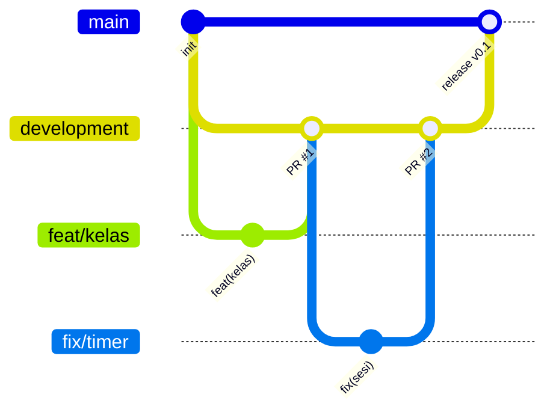

# Engineering Standard

## 1. Prinsip

1. **Solusi terkecil yang lengkap.** Jangan membuat abstraksi, opsi, atau config "untuk nanti". Ekstrak sebuah pola hanya setelah pola itu muncul tiga kali.
2. **Pakai yang sudah ada.** Urutannya: Next.js / React / Supabase bawaan → dependency yang sudah terpasang → kode baru. Jangan menambah dependency hanya untuk beberapa baris kode.
3. **Jangan pernah dipangkas:**
   - Validasi di trust boundary.
   - Otorisasi.
   - Error handling yang mencegah data hilang.
   - Aksesibilitas.

## 2. Tooling

| Area | Pilihan |
|---|---|
| Package manager | npm (registry npmjs dikunci di `.npmrc` project) |
| Bahasa | TypeScript `strict: true`, `noUncheckedIndexedAccess: true` |
| Lint/format | ESLint (config Next) + Prettier; CI gagal kalau ada warning |
| Validasi | Zod di semua input route/action, output LLM, dan env (`lib/env.ts`) |
| DB types | `supabase gen types` → `lib/supabase/types.ts` (generated, jangan diedit) |
| Migrasi | `supabase/migrations/*.sql`, termasuk policy RLS. Satu perubahan skema = satu migrasi |
| Unit/integration test | Vitest |
| E2E | Playwright (Chromium + WebKit mobile viewport) |

## 3. Struktur & penamaan

- **Struktur folder** mengikuti [architecture.md §2](architecture.md#2-struktur-modul-rencana): `app/` untuk routing, `features/<fitur>/` untuk logika dan komponen fitur, `lib/` untuk infrastruktur bersama.
- **Penamaan file:**
  - File komponen: `PascalCase.tsx`.
  - File lain: `kebab-case.ts`.
  - Hooks: `use-xxx.ts`.
- **Bahasa kode:** identifier dalam bahasa Inggris (`assignment`, `session`). Glosarium domain Indonesia → Inggris ada di [glossary.md](glossary.md). Teks UI dalam Bahasa Indonesia lewat file pesan (`messages/id.json`) supaya siap i18n.
- **Server vs client:** Server Components adalah default. `"use client"` hanya untuk komponen yang interaktif (Stage, Avatar, editor).
- **Rahasia di server:** modul yang menyentuh secret diberi `import "server-only"`.

## 4. Data & keamanan

- **Otorisasi berlapis.** Setiap Route Handler/Server Action menjalankan: autentikasi → otorisasi (role + kepemilikan) → validasi Zod → aksi.
- **RLS.** RLS aktif di **semua** tabel. Service role hanya dipakai di modul `lib/supabase/admin.ts`, setelah pengecekan otorisasi di kode.
- **Secret.**
  - Hanya ada di env server.
  - `.env*` masuk `.gitignore`.
  - `.env.example` berisi nama variabel saja.
- **Output LLM tidak dipercaya.** Hasilnya selalu divalidasi, dan dirender sebagai teks, tidak pernah lewat `dangerouslySetInnerHTML`.
- Detail lengkap: [security-privacy.md](security-privacy.md).

## 5. Testing

| Lapisan | Apa yang dites | Contoh |
|---|---|---|
| Unit | Logika murni | Hitung nilai terbaik, aturan percobaan/tenggat, pemetaan teks→viseme, parser CSV akun massal |
| Integration | Route + DB lokal (Supabase CLI) | Pelajar A tidak bisa membaca sesi pelajar B (tes RLS), mulai sesi saat percobaan habis → 403 |
| LLM contract | Gateway dengan mock HTTP | 9router 429 → fallback Gemini; JSON grader invalid → retry → fallback |
| Prompt eval | Fixture transkrip (`tests/fixtures/transcripts/*.json`) | Transkrip "dangkal" dinilai < 50, transkrip "mendalam" > 80, transkrip injection ditandai |
| E2E | Alur kritis | Daftar → gabung kelas → sesi mode teks (fallback dipaksa) → laporan |

- **Hitung tes, bukan vanity.** Setiap logika bercabang yang baru wajib punya minimal satu tes.
- **Prompt eval** dijalankan manual (`npm run eval`) setiap kali prompt berubah, karena memanggil LLM sungguhan. Hasilnya dicatat di PR.

## 6. Git & PR

Repo di **GitHub**. Alur branch:

- **Branch:**
  - `main` adalah production. Isinya hanya hasil merge dari `development` saat rilis.
  - `development` adalah branch integrasi selama masa pengembangan.
- **Wajib branch baru** untuk setiap pekerjaan: `feat/…`, `fix/…`, `docs/…`, `chore/…`, `refactor/…`. Branch dibuat dari `development`.
- **Dilarang commit langsung** ke `development` maupun `main`. Semua perubahan masuk lewat Pull Request.
- **Merge:**
  - Branch kerja → `development`: squash merge, branch dihapus setelah merge.
  - `development` → `main`: merge commit, beri tag versi (`v0.1.0`).
- **Branch protection** (GitHub) untuk `main` dan `development`:
  - Wajib lewat PR.
  - Wajib CI hijau.
  - Branch harus up to date dengan target.
  - Force push dilarang.
- **Commit:** memakai Conventional Commits (`feat(interview): fallback ke pipeline gratis saat 429`).
- **PR:**
  - Kecil, kurang dari ~400 baris diff di luar file generated.
  - Deskripsinya berisi apa, mengapa, cara uji, dan screenshot/video untuk perubahan UI (desktop + mobile).
- **CI** (GitHub Actions) berjalan di setiap PR ke `development` dan `main`:
  - Lint dan typecheck.
  - Unit + integration test (Supabase lokal via CLI).
  - Build.
  - E2E Playwright, khusus PR ke `main`.
- **Deploy:**
  - `development` → environment staging (Vercel preview + Supabase project dev).
  - `main` → production.
- **Keputusan besar** yang sulit dibalik dicatat sebagai ADR di [decisions/](decisions/).

## 7. Performa

| Budget | Target |
|---|---|
| LCP halaman editorial (4G, mobile menengah) | < 2.5 dtk |
| JS awal halaman editorial | < 180 KB gzip |
| Bundle panggung (three + vrm) | Dimuat terpisah lewat `next/dynamic`, hanya di `/sesi` |
| Ukuran per VRM | ≤ 8 MB, tekstur ≤ 1024² |
| FPS avatar | ≥ 50 desktop, ≥ 30 mobile menengah |

## 8. Definition of Done

- [ ] Acceptance criteria di user story terpenuhi.
- [ ] Tes untuk logika baru ada dan lulus; CI hijau.
- [ ] Tidak ada secret di client bundle (cek `next build` output + grep).
- [ ] Sudah dicek di desktop + mobile (360 px), keyboard-only, dan reduced-motion.
- [ ] Copy UI dalam Bahasa Indonesia mengikuti [design-system §8](design-system.md#8-suara-copy-ui-bahasa-indonesia).
- [ ] Dokumen terkait diperbarui (PRD/architecture/ADR) bila perilaku berubah.
