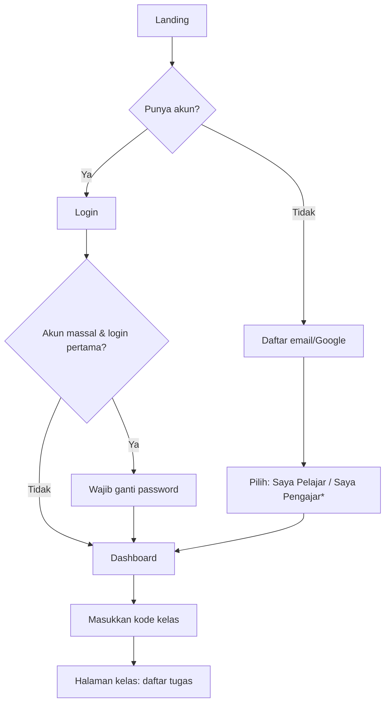
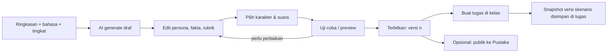
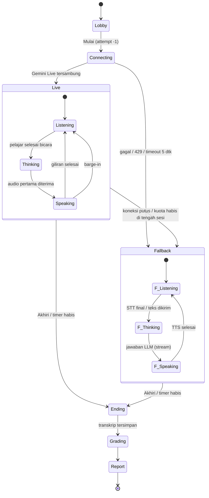
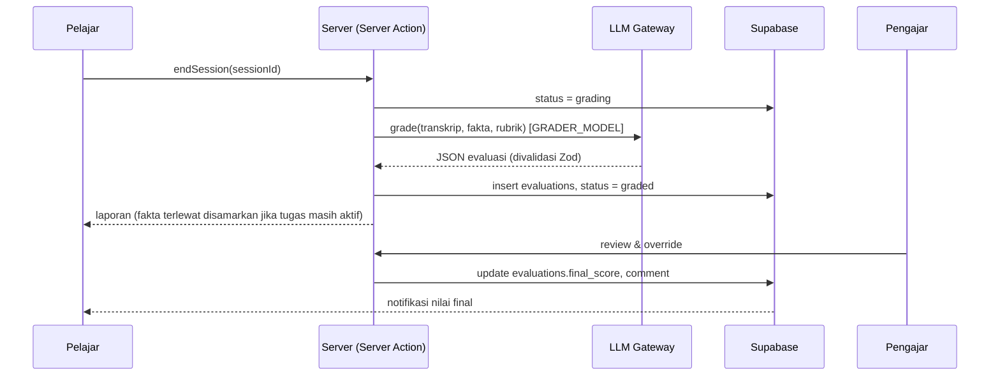

# Workflow

Alur produk utama. Untuk alur kerja developer, lihat [engineering-standard.md](engineering-standard.md).

## 1. Onboarding & gabung kelas

\* Daftar sebagai Pengajar statusnya `pending` sampai disetujui Admin. Ini mencegah orang mengaku-ngaku sebagai Pengajar.

## 2. Pembuatan skenario → tugas

## 3. State machine sesi wawancara

Aturan:

- **Satu arah.** Perpindahan ke Fallback hanya terjadi satu kali per sesi. Sesi tidak bolak-balik supaya karakter tetap konsisten.
- **Konteks dibawa.** Saat pindah, seluruh transkrip ikut dikirim sebagai riwayat ke LLM teks, jadi percakapan tetap nyambung.
- **Penyimpanan bertahap.** Setiap giliran (user dan karakter) langsung disimpan ke tabel `messages`. Ini mencegah transkrip hilang kalau sesi terputus.

## 4. Penilaian → review → laporan

Kalau grading gagal (error provider atau JSON tidak valid), sistem mencoba ulang 2× dengan backoff; di setiap percobaan gateway sudah memakai provider fallback bila provider utama gagal. Sesi yang ditutup timer tanpa "Akhiri" dinilai saat pemiliknya membuka halaman ringkasan. Sesi tanpa satu pun pertanyaan pelajar tidak dinilai. Sesi Pustaka dan preview tidak punya pengajar, jadi pemilik sesinya sendiri yang bisa menekan "Nilai ulang" saat `grading_failed`. Override pengajar tetap dipertahankan bila sesi dinilai ulang. Kalau tetap gagal, status menjadi `grading_failed`, Pengajar bisa memicu penilaian ulang, dan pelajar melihat "Penilaian sedang diproses".

## 5. Mode Pustaka (latihan bebas)

Alurnya sama dengan sesi tugas, dengan tiga perbedaan:

- Tidak ada tenggat atau batas percobaan; yang ada kuota harian (default 3 sesi per pelajar per hari).
- Laporan langsung membuka semua fakta yang terlewat.
- Nilai tidak masuk ke dashboard kelas.
